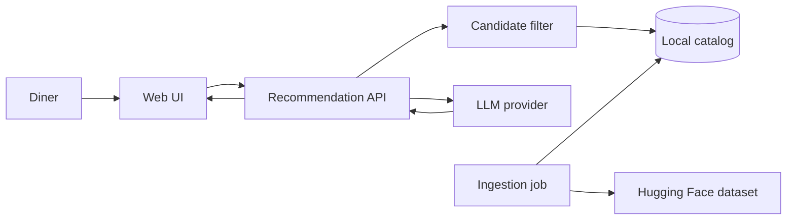
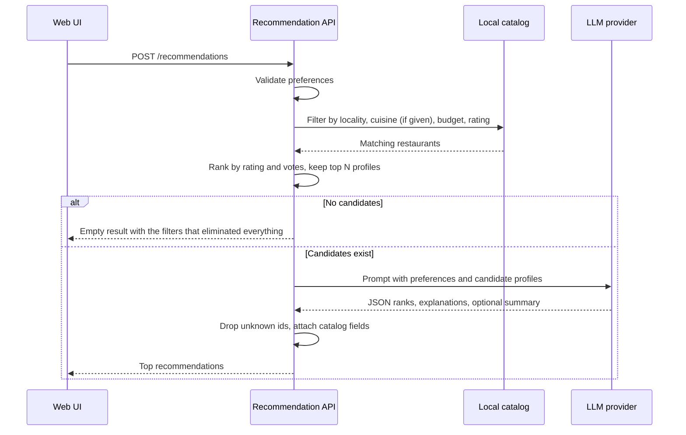

# ZomatoReco Architecture

This document describes how to build the restaurant recommendation service defined in `problemStatement.md`: collect diner preferences, narrow a real Zomato catalog with structured filters, ask a large language model to rank and explain the remaining options, and show a short list the user can act on.

The catalog is the Hugging Face dataset [ManikaSaini/zomato-restaurant-recommendation](https://huggingface.co/datasets/ManikaSaini/zomato-restaurant-recommendation): about 51,700 rows and 574 MB, covering Bangalore restaurants. The same restaurant often appears more than once because it is listed under several meal types and neighborhoods.

## Design principles

1. **Filter before the model.** Location, cuisine (when the diner picks one), budget, and minimum rating are deterministic. The LLM ranks and explains a small candidate set. It does not search the full catalog.
2. **Ground every recommendation.** Each result must refer to a restaurant id that survived filtering. Names, ratings, cuisines, and costs shown in the UI come from the catalog, and the model supplies rank and explanation only.
3. **Keep prompts small.** Full `reviews_list` values can be over a megabyte. The prompt receives a compact profile: identity, rating, votes, cost, cuisines, restaurant type, liked dishes, and at most one short review excerpt.
4. **Prepare data once.** Download, clean, and deduplicate offline. A recommendation request reads a local catalog and does not hit Hugging Face.
5. **Treat soft preferences as language.** “Family-friendly” and “quick service” are not columns. The model uses restaurant type, liked dishes, and a review excerpt to judge them, and says when the catalog does not support a claim.

## System context



| Actor | Responsibility |
| --- | --- |
| Diner | Chooses locality, budget, minimum rating, an optional cuisine (or all cuisines), and optional free-text preferences |
| Web UI | Collects input, calls the API, and renders the ranked shortlist |
| Recommendation API | Validates input, runs the filter, builds the prompt, calls the model, and returns grounded results |
| Local catalog | Cleaned, deduplicated restaurants ready for filtering |
| Ingestion job | Downloads the dataset, normalizes fields, and writes the catalog |
| LLM provider | Ranks the candidates and writes explanations from the supplied profiles only |

## Runtime request flow



Target latency for a warm catalog is a filter under a few hundred milliseconds plus one model call. The candidate cap is what keeps that call predictable.

## Components

### 1. Ingestion job

A one-shot script, re-run when the dataset should be refreshed.

Steps:

1. Load `ManikaSaini/zomato-restaurant-recommendation` with the Hugging Face `datasets` library.
2. Normalize each row into the catalog schema below.
3. Drop rows with no restaurant name.
4. Deduplicate on normalized name plus address. When duplicates disagree, keep the row with the higher vote count, then the higher rating.
5. Build lookup lists for localities and cuisines so the UI can offer real choices.
6. Write `data/catalog.parquet` (or SQLite if Parquet tooling is inconvenient) and `data/facets.json`.

Raw review blobs stay out of the catalog used at request time. Store a single excerpt of at most 400 characters, preferring a review whose numeric rating is present, so soft-preference reasoning has some text without dominating the prompt.

### 2. Catalog

One row per restaurant.

| Field | Source | Normalization |
| --- | --- | --- |
| `id` | Generated | Stable hash of normalized name and address |
| `name` | `name` | Trimmed, encoding repaired where obvious |
| `address` | `address` | Trimmed |
| `locality` | `location` | Trimmed; this is a Bangalore neighborhood such as Banashankari, not a city |
| `listed_city` | `listed_in(city)` | Kept for display context |
| `cuisines` | `cuisines` | Lowercased list split on commas |
| `rest_type` | `rest_type` | List split on commas, for example Cafe, Quick Bites, Casual Dining |
| `cost_for_two` | `approx_cost(for two people)` | Integer rupees; commas removed |
| `rating` | `rate` | Float from values like `4.1/5`; unparseable values become null |
| `votes` | `votes` | Integer |
| `online_order` | `online_order` | Boolean |
| `book_table` | `book_table` | Boolean |
| `dish_liked` | `dish_liked` | Short list, capped |
| `review_excerpt` | `reviews_list` | One short plain-text excerpt |
| `url` | `url` | Original Zomato link, shown as a reference and never sent as a ranking signal |

`phone` and full `menu_item` / `reviews_list` payloads are omitted from the request-time catalog. They are large, uneven, and unused by the recommendation contract.

**Budget bands** are applied to `cost_for_two` and kept in configuration so they can be tuned:

| Band | Cost for two (INR) |
| --- | --- |
| low | up to 400 |
| medium | 401 to 800 |
| high | above 800 |

Rows with a null cost fail a budget filter. Rows with a null rating fail a minimum-rating filter. The API reports how many rows each rule removed so an empty screen is explainable.

**Locality scope.** The problem statement lists Delhi and Bangalore as examples. This dataset’s `location` values are Bangalore neighborhoods (about 93). The UI asks for a locality from `facets.json`. A later catalog of other cities can reuse the same field without changing the request contract: `locality` remains the filter key.

### 3. Recommendation API

A small HTTP service. FastAPI is a good fit because the ingestion code, filtering, and model client are all Python.

`POST /recommendations`

```json
{
  "locality": "Banashankari",
  "budget": "medium",
  "cuisine": "Italian",
  "min_rating": 4.0,
  "preferences": "family-friendly, quick service",
  "limit": 5
}
```

| Field | Rule |
| --- | --- |
| `locality` | Required. Case-insensitive match against known localities |
| `budget` | Required. One of `low`, `medium`, `high` |
| `cuisine` | Optional. Case-insensitive substring match against any cuisine tag. Omitted, blank, `all`, `all cuisines`, or `any` means all cuisines (no cuisine filter) |
| `min_rating` | Required. Number from 0 to 5 |
| `preferences` | Optional free text, length-capped (for example 300 characters) |
| `limit` | Optional. Default 5, maximum 8 |

`GET /facets` returns sorted localities and cuisines from `facets.json` so the form does not invent values the catalog cannot match.

Validation failures return HTTP 400 with field errors. A cuisine that is given but matches no tag is a validation failure; a missing cuisine is not. A valid query that matches nothing returns HTTP 200 with an empty list and a `filter_stats` object.

A request for every cuisine looks like this:

```json
{ "locality": "Jayanagar", "budget": "low", "min_rating": 4.3 }
```

### 4. Candidate filter

Pure functions over the in-memory catalog (loaded once at process start). Order of operations:

1. Locality equality on the normalized locality.
2. Cuisine tag contains the requested cuisine. With no cuisine, this rule keeps every row but still reports its counts, so `filter_stats` always lists the same four rules.
3. Cost falls inside the budget band.
4. Rating is present and greater than or equal to `min_rating`.
5. Sort the survivors by rating descending, then votes descending.
6. Keep the top `candidate_pool` rows (default 20) as model input.

If fewer than `limit` restaurants survive, the API still calls the model on whatever remains, down to one row. Zero rows skip the model call.

The pre-sort is a recall aid. The model may reorder the pool using cuisine fit, restaurant type, liked dishes, and the free-text preferences. It may not add restaurants from outside the pool.

### 5. Prompt and model client

One chat completion per request. The provider is Groq (`openai/gpt-oss-120b` by default), reached through its OpenAI-compatible API. It sits behind a thin interface (`complete(system, user) -> str`) so the HTTP and parsing code stay the same for other OpenAI-compatible providers or a local model. The model name, base URL, API key, and response format come from environment variables. By default the client asks for strict JSON Schema output; see `implementation-plan.md` Phase 4 for the Groq details.

**System prompt duties**

- Rank only the supplied restaurants.
- Use catalog facts for rating, cost, and cuisine. Do not invent dishes, awards, or ambience.
- Use `preferences` only when `rest_type`, `dish_liked`, or `review_excerpt` supports the claim. Otherwise say the catalog does not show that trait.
- Return JSON only, matching the schema below.
- Produce at most `limit` items, best first.

**User message contents**

- The request: locality, cuisine (or “any (no cuisine filter)” when none was chosen, so the model does not favour one), budget band with its ₹ range, and minimum rating.
- The normalized preferences.
- A JSON array of candidate profiles: `id`, `name`, `locality`, `cuisines`, `rest_type`, `cost_for_two`, `rating`, `votes`, `online_order`, `book_table`, `dish_liked`, `review_excerpt`.

**Expected model JSON**

```json
{
  "summary": "Short paragraph comparing the set.",
  "recommendations": [
    {
      "id": "catalog-id",
      "rank": 1,
      "explanation": "Two or three sentences tied to the user's preferences."
    }
  ]
}
```

**Response assembly**

1. Parse JSON. If the model wraps it in markdown fences, strip one fence pair and parse again.
2. On parse failure, retry once with a shorter repair prompt that includes the invalid text. A second failure returns HTTP 502 and does not show partial prose as if it were a ranking.
3. Drop recommendation objects whose `id` is not in the candidate pool.
4. Sort by `rank`.
5. Join each surviving id to catalog fields. The UI-bound rating, cost, cuisine, and name always come from the catalog.
6. If every id was dropped, return HTTP 502 rather than an empty success, because the filter did find restaurants and the model failed to ground them.

Temperature stays low (around 0.2) so rankings are stable across repeated clicks.

### 6. Web UI

A single page served by FastAPI (`app/static/`: HTML, CSS, and plain JavaScript, no build step or external assets). Its heading is **“Recommendation engine”** with the tagline **“Let's make eating fun.”**

**Behavior**

- Locality and cuisine are searchable inputs (`<input list>` with a `<datalist>`) fed by `GET /facets`. Locality is required and must be a facet value.
- Cuisine is optional. The list starts with **“All cuisines”**; choosing it or leaving the field blank sends no `cuisine`. A typed value that is neither a facet nor “All cuisines” is blocked before any request.
- Budget is three pill buttons showing their ₹ ranges. Minimum rating is a slider from 0 to 5, step 0.1. Preferences are an optional text field (placeholder “family-friendly, quick service”, 300-character counter).
- Submit calls `POST /recommendations` and shows a loading state for the model call. A newer search replaces one still running; the browser gives up after 60 seconds.
- Each card shows restaurant name, cuisine, rating, estimated cost for two, and the AI explanation, in that order, plus a “View on Zomato” link for `http`/`https` URLs.
- A summary paragraph sits above the cards when the model returns one.
- An empty state names the filter that removed every row in one sentence and invites the user to widen locality, cuisine, budget, or rating.
- Errors from validation appear next to their fields; model and server errors appear as plain sentences, and earlier cards are cleared.
- All server text is inserted as text, never HTML, because it comes from scraped listings and a language model.

**Look and feel**

- Pastel palette (pink, mint, butter yellow, lavender, peach, sky) on a dotted cream background, with dark outlines and hard pastel shadows. Text stays dark plum on pastels for contrast. Dark mode follows the system setting.
- Inline SVG food illustrations with small faces (burger, nigiri sushi, maki, pizza, donut, boba) in the header and margins; a rolling maki is the loading spinner and a donut marks the empty state.
- One column below 780px; no horizontal scroll at 400px. Animations stop under `prefers-reduced-motion`.

A separate React app is optional and would not change the API.

## Suggested repository layout

```text
ZomatoReco/
  architecture.md
  problemStatement.md
  README.md
  requirements.txt
  .env.example
  app/
    main.py              # HTTP routes
    schemas.py           # request and response models
    catalog.py           # load catalog, facets, filters
    recommend.py         # pool selection, prompt, grounding
    llm.py               # provider client
    static/
      index.html         # the diner page
      styles.css
      app.js
  ingest/
    build_catalog.py     # Hugging Face download and normalization
  data/                  # generated, gitignored
    catalog.parquet
    facets.json
  tests/
    test_normalize.py
    test_filter.py
    test_api.py
    test_grounding.py
    test_ui.py
```

`data/` is generated and stays out of git. `.env` holds the model API key and stays out of git. `.env.example` lists the variable names without secrets.

## Configuration

| Variable | Purpose |
| --- | --- |
| `LLM_BASE_URL` | OpenAI-compatible endpoint (`https://api.groq.com/openai/v1`) |
| `LLM_API_KEY` | Secret for that endpoint, kept only in `.env` |
| `LLM_MODEL` | Model name (`openai/gpt-oss-120b`) |
| `LLM_RESPONSE_FORMAT` | `json_schema` (default), `json_object`, or `off` |
| `CATALOG_PATH` | Path to the local catalog |
| `CANDIDATE_POOL` | Max restaurants sent to the model (default 20) |
| `DEFAULT_LIMIT` | Recommendations returned (default 5) |

Budget thresholds live in code next to the filter so tests can pin them.

## Failure behavior

| Situation | Behavior |
| --- | --- |
| Unknown locality, or a given cuisine that matches no tag | 400 with the closest message that the value is not in the catalog facets |
| Cuisine omitted, blank, or “all” | Not an error: every cuisine is considered |
| Budget or rating out of range | 400 |
| Catalog file missing | 503 asking the operator to run the ingestion job |
| Zero restaurants after filters | 200, empty list, filter stats |
| Model timeout or HTTP error | 502, no fabricated list |
| Model JSON invalid twice | 502 |
| Model cites ids outside the pool | Those items are removed; remaining items are returned |

## Testing

Tests stay offline. They do not call Hugging Face or a live model.

- **Normalization:** `4.1/5` becomes `4.1`; `1,000` cost becomes `1000`; comma-separated cuisines become a list; duplicate name-and-address rows collapse.
- **Filter:** a fixture of a few restaurants checks locality, cuisine substring, no cuisine (all cuisines), each budget band, minimum rating, null rating, and null cost.
- **API:** 400 field errors, 503, 200-empty, a shortlist matching the fixture, and requests without a cuisine.
- **Grounding:** a fake model client returns one known id, one unknown id, and fenced JSON. The assembler keeps the known id, fills rating and cost from the fixture, and rejects an all-unknown payload.

A manual check after ingestion confirms `GET /facets` lists Bangalore localities such as Banashankari, and a sample query (medium budget, a common cuisine, minimum rating 4) returns cards whose numbers match the catalog.

## Build order

1. Ingestion script and catalog schema, including deduplication and facet files.
2. Filter functions and their tests.
3. API schemas, `GET /facets`, and `POST /recommendations` returning the deterministic top restaurants with a placeholder explanation.
4. Model client, prompt, JSON parsing, and id grounding.
5. Single-page pastel UI wired to both endpoints, including optional cuisine and the empty state.
6. Manual pass against a live model key with the sample preferences from the problem statement.

Step 3 is intentionally useful before any API key exists: the page can already show name, cuisine, rating, and cost. Step 4 replaces the placeholder explanation with the model text.

## Out of scope for the first version

Accounts, saved preferences, live Zomato search, maps, booking, and multi-turn chat. Those can sit on the same catalog and API later. The first version is complete when a diner submits the preferences in the problem statement (with cuisine optional) and sees a ranked, explained shortlist whose facts come from the local catalog.
